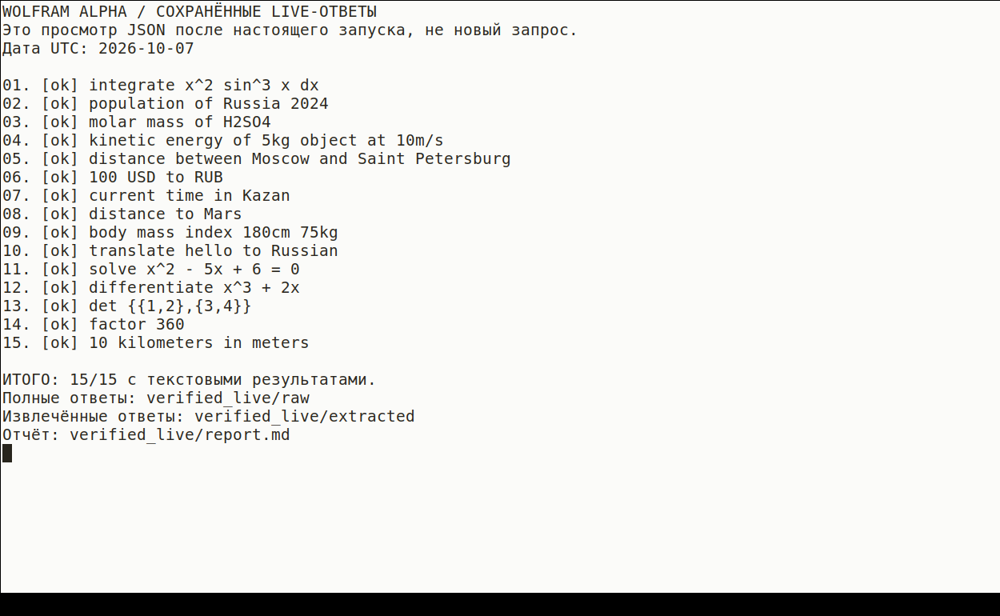

# Лабораторная работа №1
## Интеграция экспертной системы Wolfram Alpha через API

Вуз: ______________________________

Дисциплина: ________________________

Выполнил: __________________________

Группа: ____________________________

Преподаватель: _____________________

Город и год: _______________________

Статус: программа проверена 28 локальными тестами и настоящим пакетом из 15 запросов. Все 15 получили текстовые результаты; AppID в отчёт и исходники не включён.

```{=openxml}
<w:p><w:r><w:br w:type="page"/></w:r></w:p>
```

## Цель и задание

Цель: реализовать программное взаимодействие с Wolfram Alpha через API, обработать структурированный ответ и сохранить результаты. Основание: приложенный PDF «Лабораторная 1. Wolfram», страницы 9–10.

Реализован Python-клиент для 10 обязательных запросов и 5 дополнительных. Программа разделена на конфигурацию, список запросов, HTTP-клиент, обработку ответа, сохранение данных и управляющий модуль.

## Реализованные запросы

| № | Категория | Текст запроса |
|---|---|---|
| 1 | Математика | `integrate x^2 sin^3 x dx` |
| 2 | Фактология | `population of Russia 2024` |
| 3 | Химия | `molar mass of H2SO4` |
| 4 | Физика | `kinetic energy of 5kg object at 10m/s` |
| 5 | География | `distance between Moscow and Saint Petersburg` |
| 6 | Финансы | `100 USD to RUB` |
| 7 | Время | `current time in Kazan` |
| 8 | Астрономия | `distance to Mars` |
| 9 | Индекс массы тела | `body mass index 180cm 75kg` |
| 10 | Лингвистика | `translate hello to Russian` |
| 11 | Уравнение | `solve x^2 - 5x + 6 = 0` |
| 12 | Производная | `differentiate x^3 + 2x` |
| 13 | Определитель | `det {{1,2},{3,4}}` |
| 14 | Факторизация | `factor 360` |
| 15 | Единицы измерения | `10 kilometers in meters` |

Первые десять формулировок сохранены дословно из задания. Дополнительные запросы выбраны так, чтобы их результат можно было независимо проверить вычислением.

## Архитектура программы

- **`configuration.py`:** читает JSON-конфигурацию и проверяет AppID, тайм-аут, число повторов и паузу.
- **`queries.py`:** содержит неизменяемый порядок 15 запросов.
- **`client.py`:** выполняет HTTPS GET, ограничивает ожидание и повторяет временные сбои.
- **`processing.py`:** обрабатывает статус, ошибки, блоки `pods` и текст `plaintext`.
- **`storage.py`:** записывает JSON и Markdown; маскирует случайно попавший в данные ключ.
- **`main.py`:** последовательно выполняет пакет, пишет журнал и выводит результаты.
- **`setup_config.py`:** создаёт локальную конфигурацию через скрытый ввод.
- **`demo_data.py`:** задаёт явно помеченные синтетические тестовые ответы.
- **`test_lab.py`:** проверяет обработку данных, ошибки, конфигурацию и сохранение файлов.

Для сетевого запуска используются параметры `appid`, `input`, `output=json`, `format=plaintext`. Формат всего ответа и формат содержимого блоков задаются независимо согласно [документации Full Results API](https://products.wolframalpha.com/api/documentation).

## Алгоритм обработки

1. Проверить конфигурационный файл и создать новую папку результатов.
2. Выбрать очередной запрос из `QUERIES`.
3. Получить JSON через клиент или синтетический ответ в явно выбранном режиме `--demo`.
4. Сохранить полный ответ в `raw`.
5. Проверить `queryresult.error` и `queryresult.success`.
6. Собрать все непустые `plaintext` из `pods[].subpods[]`.
7. Сохранить извлечённую запись и перейти к следующему запросу.
8. Записать сводный JSON и читаемый Markdown-отчёт.

Статусы `ok`, `api_error`, `no_result`, `no_text`, `invalid_response`, `request_error` различают успешный текст, ошибку API, отсутствие решения, отсутствие текста, неверную структуру и транспортную ошибку. Даже при HTTP 200 программа отдельно проверяет содержимое API-ответа.

## Обработка ошибок и безопасность

Временные сетевые ошибки, HTTP 429 и HTTP 5xx повторяются до заданного предела. При стандартной конфигурации выполняется максимум три попытки одного запроса: первая и две повторные.

HTTP 401 и другие неповторяемые HTTP-ошибки фиксируются сразу. Для ответа, который нельзя разобрать как JSON, сохраняется тело ошибки; ключ и полный URL с ключом не записываются в журнал.

`config.json` не входит в распространяемый комплект и исключён из Git. Исходные данные ответов сохраняются полностью, кроме маскирования AppID, если он неожиданно присутствует в ответе.

## Запуск на macOS

Из корня распакованного комплекта:

```bash
python3 Lab_1_Wolfram/setup_config.py
python3 Lab_1_Wolfram/main.py
```

Для автономной проверки:

```bash
python3 Lab_1_Wolfram/main.py --demo
cd Lab_1_Wolfram
python3 -m unittest -v
```

Проект использует стандартную библиотеку, установка дополнительных Python-пакетов не требуется. Общая установка Python на Mac описана в [официальном руководстве](https://docs.python.org/3/using/mac.html).

## Результаты локальной проверки

В среде подготовки выполнены 28 тестов Python, все прошли. Проверены успешный ответ, пустой результат, ошибки API, отсутствие текстовых блоков, сетевые сбои, повторы HTTP 429/503, неповторяемый HTTP 401, неверный JSON, конфигурация, продолжение пакета после ошибки и сохранение 15 пар файлов.

Демонстрационный пакет содержит 7 синтетических примеров с вычислениями и 8 синтетических примеров без результата. В нём нет сведений о текущем курсе, населении или расстоянии до Марса, выдаваемых за реальные ответы сервиса.

## Результаты настоящего запуска

7 октября 2026 года выполнен полный пакет из 15 последовательных запросов с предоставленным AppID. Для каждого запрос завершился статусом `ok`, то есть API вернул успешный ответ и непустые текстовые блоки.

Фактические результаты находятся в `verified_live/raw`, `verified_live/extracted`, `verified_live/summary.json`, `verified_live/report.md` и `verified_live/run.log`. Текст полного консольного вывода также приложен в `live_console.txt`; его содержимое получено программой, а не составлено вручную.

Запросы выполнялись в среде подготовки через защищённый HTTPS-прокси, подставляющий AppID. Для совместимости с сертификатом прокси использован транспортный адаптер; проверка цепочки сертификатов и имени хоста не отключалась. На Mac выполняется обычный вариант клиента с `config.json`, без адаптера среды подготовки.

Ключевые контрольные вычисления совпали: кинетическая энергия 250 Дж, корни 2 и 3, производная `3 x^2 + 2`, определитель -2 и перевод 10 км в 10000 м. Эти значения можно проверить непосредственно по формулам и выражениям задания.

Вывод API не равнозначен независимому подтверждению каждого справочного сведения. Например, у населения нужно сохранять обозначения оценки и года, расстояние между городами нельзя автоматически называть длиной автодороги, а курс, время и расстояние до Марса относятся к дате ответа.

## Пример вывода и скриншот

Приложенный снимок показывает реальный запуск просмотрщика сохранённых LIVE-ответов в Linux-терминале среды подготовки. Это не скриншот macOS; просмотрщик читает настоящие JSON из `verified_live` и не выполняет повторные сетевые запросы.



Перед защитой рекомендуется повторить запуск без `--demo` на своём Mac и при необходимости заменить снимок собственным. На Mac область экрана снимается сочетанием Shift–Command–4: [инструкция Apple](https://support.apple.com/en-us/102646).

Для просмотра сохранённых результатов:

```bash
python3 Lab_1_Wolfram/show_saved_results.py
```

Демонстрационный пример отдельно хранится в `example_demo`; его снимок называется `demo_screenshot.png`. Он нужен только для автономной проверки и явно не обозначается как ответ API.

## Вывод

Разработан модульный клиент, реализующий все 15 запросов, разбор JSON, логирование и раздельное сохранение результатов. Локальная логика подтверждена тестами, а интеграция подтверждена сохранёнными успешными ответами на все 15 запросов.

Демонстрационный режим не заменяет выполнение сетевой части. Он сохранён как дополнительный инструмент проверки без доступа к аккаунту и отделён от реальных результатов.


## Приложение: основные результаты настоящего запуска

Ниже дословные основные текстовые блоки сохранённых ответов API от 7 октября 2026 года.
Это результаты лабораторного запуска, не независимая проверка справочных, финансовых или медицинских сведений.
Динамические значения относятся к дате ответа. Полный контекст находится в папке verified_live/raw.

### 01. Математический

Запрос: `integrate x^2 sin^3 x dx`

UTC: 2026-10-07T14:06:05.371590+00:00. Статус: ok.

```text
integral x^2 sin^3(x) dx = 1/108 (-81 (x^2 - 2) cos(x) + (9 x^2 - 2) cos(3 x) - 6 x (sin(3 x) - 27 sin(x))) + constant
```

### 02. Фактологический

Запрос: `population of Russia 2024`

UTC: 2026-10-07T14:06:10.157362+00:00. Статус: ok.

```text
145 million people (2023 projection) (world rank: 9th) (2024 estimate)
```

### 03. Химический

Запрос: `molar mass of H2SO4`

UTC: 2026-10-07T14:06:14.088017+00:00. Статус: ok.

```text
98.07 g/mol (grams per mole)
```

### 04. Физический

Запрос: `kinetic energy of 5kg object at 10m/s`

UTC: 2026-10-07T14:06:16.219506+00:00. Статус: ok.

```text
kinetic energy | 250 J (joules)
= 0.06944 W h (watt hours)
= 1.56 × 10^12 GeV (gigaelectronvolts)
```

### 05. Географический

Запрос: `distance between Moscow and Saint Petersburg`

UTC: 2026-10-07T14:06:18.673471+00:00. Статус: ok.

```text
395.3 miles
```

### 06. Финансовый

Запрос: `100 USD to RUB`

UTC: 2026-10-07T14:06:21.111057+00:00. Статус: ok.

```text
8475.17 ₽ (Russian rubles) (October 6, 2026)
```

### 07. Временной

Запрос: `current time in Kazan`

UTC: 2026-10-07T14:06:23.575339+00:00. Статус: ok.

```text
5:06:24 pm MSK | Wednesday, October 7, 2026
```

### 08. Астрономический

Запрос: `distance to Mars`

UTC: 2026-10-07T14:06:25.442654+00:00. Статус: ok.

```text
1.619 au (astronomical units)
```

### 09. Индекс массы тела

Запрос: `body mass index 180cm 75kg`

UTC: 2026-10-07T14:06:28.267462+00:00. Статус: ok.

```text
body mass index | 23.15
```

### 10. Лингвистический

Запрос: `translate hello to Russian`

UTC: 2026-10-07T14:06:32.261575+00:00. Статус: ok.

```text
(noun) привет | приветствие
Здравствуйте
```

### 11. Дополнительный: уравнение

Запрос: `solve x^2 - 5x + 6 = 0`

UTC: 2026-10-07T14:06:33.796748+00:00. Статус: ok.

```text
x = 2
x = 3
```

### 12. Дополнительный: производная

Запрос: `differentiate x^3 + 2x`

UTC: 2026-10-07T14:06:35.629466+00:00. Статус: ok.

```text
d/dx(x^3 + 2 x) = 3 x^2 + 2
x = -i sqrt(2/3)
x = i sqrt(2/3)
integral(2 + 3 x^2) dx = x^3 + 2 x + constant
```

### 13. Дополнительный: определитель

Запрос: `det {{1,2},{3,4}}`

UTC: 2026-10-07T14:06:37.357673+00:00. Статус: ok.

```text
-2
```

### 14. Дополнительный: разложение

Запрос: `factor 360`

UTC: 2026-10-07T14:06:38.842863+00:00. Статус: ok.

```text
2^3 × 3^2 × 5 (6 prime factors, 3 distinct)
```

### 15. Дополнительный: единицы

Запрос: `10 kilometers in meters`

UTC: 2026-10-07T14:06:40.228317+00:00. Статус: ok.

```text
10000 meters
```


## Приложение: статусы настоящего пакета

```text
WOLFRAM ALPHA / СОХРАНЁННЫЕ LIVE-ОТВЕТЫ
Это просмотр JSON после настоящего запуска, не новый запрос.
Дата UTC: 2026-10-07

01. [ok] integrate x^2 sin^3 x dx
02. [ok] population of Russia 2024
03. [ok] molar mass of H2SO4
04. [ok] kinetic energy of 5kg object at 10m/s
05. [ok] distance between Moscow and Saint Petersburg
06. [ok] 100 USD to RUB
07. [ok] current time in Kazan
08. [ok] distance to Mars
09. [ok] body mass index 180cm 75kg
10. [ok] translate hello to Russian
11. [ok] solve x^2 - 5x + 6 = 0
12. [ok] differentiate x^3 + 2x
13. [ok] det {{1,2},{3,4}}
14. [ok] factor 360
15. [ok] 10 kilometers in meters

ИТОГО: 15/15 с текстовыми результатами.
Полные ответы: verified_live/raw
Извлечённые ответы: verified_live/extracted
Отчёт: verified_live/report.md
```


## Приложение: отдельный синтетический пример

```text
РЕЖИМ: ДЕМО / СИНТЕТИЧЕСКИЕ ДАННЫЕ / БЕЗ API
01. kinetic energy of 5kg object at 10m/s
    [ok]
    Synthetic input: kinetic energy of 5kg object at 10m/s
    SYNTHETIC control value: 250 J [контроль: 5 * 10^2 / 2]
02. body mass index 180cm 75kg
    [ok]
    Synthetic input: body mass index 180cm 75kg
    SYNTHETIC control value: 23.148148... kg/m^2 [контроль: 75 / 1.8^2]
03. solve x^2 - 5x + 6 = 0
    [ok]
    Synthetic input: solve x^2 - 5x + 6 = 0
    SYNTHETIC control value: x = 2 or x = 3 [контроль: (x-2)(x-3)=0]

Обработано: 3. С текстовым результатом: 3.
Файлы: Lab_1_Wolfram/output/preview_...
```

## Приложение: полный листинг основных модулей

Тесты находятся в отдельных файлах комплекта. Ниже приведены исходники, формирующие результат.

### configuration.py

```python
"""Чтение конфигурации. AppID не находится в исходном коде."""
import json
import math
from pathlib import Path

ROOT = Path(__file__).resolve().parent


def load_config(path=ROOT / "config.json"):
    try:
        data = json.loads(Path(path).read_text(encoding="utf-8"))
    except FileNotFoundError:
        raise ValueError("Нет config.json. Выполните: python3 setup_config.py") from None
    except (OSError, UnicodeError, json.JSONDecodeError):
        raise ValueError("Не удалось прочитать config.json: проверьте UTF-8 и JSON.") from None
    if not isinstance(data, dict):
        raise ValueError("config.json должен содержать JSON-объект.")
    key = data.get("appid")
    if not isinstance(key, str) or not key.strip() or key == "PUT_YOUR_APPID_HERE":
        raise ValueError("В config.json не заполнен appid.")
    data["appid"] = key.strip()
    for field, default, lower, upper in [
        ("timeout_seconds", 30, 1, 120),
        ("delay_seconds", 1, 0, 30),
        ("retries", 2, 0, 5),
    ]:
        value = data.get(field, default)
        if (isinstance(value, bool) or not isinstance(value, (int, float))
                or not math.isfinite(value) or not lower <= value <= upper):
            raise ValueError(f"Недопустимое значение {field}: диапазон {lower}..{upper}.")
        if field == "retries" and not isinstance(value, int):
            raise ValueError("retries должен быть целым числом.")
        data[field] = value
    return data
```

### queries.py

```python
"""Первые 10 запросов точно соответствуют методичке, ещё 5 выбраны."""
QUERIES = [
    ("math", "Математический", "integrate x^2 sin^3 x dx"),
    ("fact", "Фактологический", "population of Russia 2024"),
    ("chemistry", "Химический", "molar mass of H2SO4"),
    ("physics", "Физический", "kinetic energy of 5kg object at 10m/s"),
    ("geography", "Географический", "distance between Moscow and Saint Petersburg"),
    ("finance", "Финансовый", "100 USD to RUB"),
    ("time", "Временной", "current time in Kazan"),
    ("astronomy", "Астрономический", "distance to Mars"),
    ("bmi", "Индекс массы тела", "body mass index 180cm 75kg"),
    ("language", "Лингвистический", "translate hello to Russian"),
    ("equation", "Дополнительный: уравнение", "solve x^2 - 5x + 6 = 0"),
    ("derivative", "Дополнительный: производная", "differentiate x^3 + 2x"),
    ("determinant", "Дополнительный: определитель", "det {{1,2},{3,4}}"),
    ("prime", "Дополнительный: разложение", "factor 360"),
    ("units", "Дополнительный: единицы", "10 kilometers in meters"),
]
```

### client.py

```python
"""HTTPS-клиент Full Results API, только стандартная библиотека Python."""
import json
import logging
import socket
import time
from urllib.error import HTTPError, URLError
from urllib.parse import urlencode
from urllib.request import Request, urlopen

ENDPOINT = "https://api.wolframalpha.com/v2/query"


class RequestFailure(Exception):
    """Безопасное сообщение: URL с ключом никогда не попадает в лог."""

    def __init__(self, message, raw_body=None):
        super().__init__(message)
        self.raw_body = raw_body


class WolframClient:
    def __init__(self, config, opener=urlopen, sleeper=time.sleep):
        self.config = config
        self.opener = opener
        self.sleep = sleeper

    def query(self, text):
        params = {"input": text, "output": "json", "format": "plaintext"}
        # При обычном запуске ключ читается из config.json.
        # В защищённой проверочной среде допускается его подстановка HTTPS-прокси.
        if self.config.get("appid"):
            params["appid"] = self.config["appid"]
        request = Request(
            ENDPOINT + "?" + urlencode(params),
            headers={"Accept": "application/json", "User-Agent": "EducationalLab/1.0"},
        )
        retries = self.config["retries"]
        for attempt in range(retries + 1):
            try:
                with self.opener(request, timeout=self.config["timeout_seconds"]) as response:
                    raw = response.read().decode("utf-8", errors="replace")
                try:
                    data = json.loads(raw)
                except json.JSONDecodeError:
                    raise RequestFailure("Сервер вернул не JSON.", raw) from None
                if not isinstance(data, dict):
                    raise RequestFailure("Корень ответа API не является объектом.", raw)
                return data
            except HTTPError as error:
                body = error.read().decode("utf-8", errors="replace")
                can_retry = error.code == 429 or 500 <= error.code < 600
                if not can_retry or attempt == retries:
                    raise RequestFailure(f"HTTP {error.code}", body) from None
                logging.warning("HTTP %s; повтор %s/%s", error.code, attempt + 1, retries)
            except (URLError, TimeoutError, socket.timeout, ConnectionError, OSError):
                if attempt == retries:
                    raise RequestFailure("Сетевая ошибка или тайм-аут.") from None
                logging.warning("Сетевая ошибка; повтор %s/%s", attempt + 1, retries)
            self.sleep(2 ** attempt)
        raise RequestFailure("Не удалось выполнить запрос.")
```

### processing.py

```python
"""Извлечение всех текстовых блоков, а не только первого Result."""


def is_true(value):
    return value is True or value == "true"


def extract(data):
    root = data.get("queryresult")
    if not isinstance(root, dict):
        return {"status": "invalid_response", "message": "Нет объекта queryresult.", "pods": []}
    error = root.get("error", False)
    if isinstance(error, dict) or is_true(error):
        message = error.get("msg", "Ошибка API.") if isinstance(error, dict) else "Ошибка API."
        return {"status": "api_error", "message": str(message), "pods": []}
    if not is_true(root.get("success")):
        return {
            "status": "no_result",
            "message": "API не выдал успешного результата; проверьте raw и формулировку.",
            "pods": [],
        }
    pods = []
    raw_pods = root.get("pods", [])
    if not isinstance(raw_pods, list):
        return {"status": "invalid_response", "message": "Поле pods не является списком.", "pods": []}
    for pod in raw_pods:
        if not isinstance(pod, dict):
            continue
        blocks = []
        subpods = pod.get("subpods", [])
        if isinstance(subpods, list):
            for subpod in subpods:
                if not isinstance(subpod, dict):
                    continue
                plain = subpod.get("plaintext")
                if isinstance(plain, str) and plain.strip():
                    blocks.append(plain.strip())
        if blocks:
            pods.append({
                "id": pod.get("id", ""),
                "title": pod.get("title", ""),
                "primary": is_true(pod.get("primary", False)),
                "text": blocks,
            })
    if not pods:
        return {"status": "no_text", "message": "Успешный ответ без plaintext.", "pods": []}
    return {"status": "ok", "message": "", "pods": pods}
```

### storage.py

```python
"""Полные ответы и извлечённые данные сохраняются раздельно."""
import json
from pathlib import Path


def write_json(path, value):
    Path(path).write_text(json.dumps(value, ensure_ascii=False, indent=2), encoding="utf-8")


def redact(value, secret):
    """Не допускаем случайного попадания AppID в отчёты или ошибки."""
    if not secret:
        return value
    if isinstance(value, str):
        return value.replace(secret, "[REDACTED_APPID]")
    if isinstance(value, list):
        return [redact(item, secret) for item in value]
    if isinstance(value, dict):
        return {key: redact(item, secret) for key, item in value.items()}
    return value


def write_report(folder, records, mode):
    lines = [
        "# Результаты Wolfram Alpha",
        "",
        f"Режим: {mode}.",
        ("ДЕМО: синтетические тестовые данные, запросы к API не выполнялись."
         if mode == "demo" else "LIVE: ответы получены при сетевом запуске, см. время у каждого запроса."),
        "",
    ]
    for row in records:
        lines.extend([
            f"## {row['number']:02d}. {row['category']}",
            "",
            f"Запрос: `{row['query']}`",
            "",
            f"Время UTC: {row['timestamp_utc']}. Статус: {row['status']}.",
            "",
        ])
        if row["message"]:
            lines.extend([row["message"], ""])
        for pod in row["pods"]:
            lines.extend([f"### {pod['title']}", "", *pod["text"], ""])
    Path(folder, "report.md").write_text("\n".join(lines), encoding="utf-8")
```

### main.py

```python
"""Запуск: python3 main.py --demo или python3 main.py (настоящий API)."""
import argparse
from datetime import datetime, timezone
import logging
from pathlib import Path
import sys
import time

from client import WolframClient, RequestFailure
from configuration import ROOT, load_config
from demo_data import synthetic_response
from processing import extract
from queries import QUERIES
from storage import redact, write_json, write_report


def run_batch(config, folder, demo=False, queries=QUERIES, client=None):
    folder = Path(folder)
    (folder / "raw").mkdir(parents=True, exist_ok=True)
    (folder / "extracted").mkdir(exist_ok=True)
    mode = "demo" if demo else "live"
    print("РЕЖИМ: " + ("ДЕМО / СИНТЕТИЧЕСКИЕ ДАННЫЕ / БЕЗ API" if demo else "LIVE / WOLFRAM API"))
    records = []
    client = client or (None if demo else WolframClient(config))
    for number, (query_id, category, query) in enumerate(queries, 1):
        timestamp = datetime.now(timezone.utc).isoformat()
        logging.info("Запрос %02d/%02d: %s", number, len(queries), query)
        filename = f"{number:02d}_{query_id}.json"
        secret = config.get("appid", "")
        try:
            raw = synthetic_response(query_id, query) if demo else client.query(query)
            raw = redact(raw, secret)
            write_json(folder / "raw" / filename, raw)
            parsed = extract(raw)
        except RequestFailure as error:
            parsed = {"status": "request_error", "message": str(error), "pods": []}
            write_json(folder / "raw" / filename, {
                "_notice": "Транспортная ошибка; корректный JSON-ответ не получен.",
                "message": redact(str(error), secret),
                "response_body": redact(error.raw_body, secret),
            })
        if demo and parsed["status"] == "no_result":
            parsed["message"] = "Демо моделирует отсутствие ответа. Реальный запрос здесь не выполнялся."
        row = {
            "number": number, "id": query_id, "category": category,
            "query": query, "mode": mode, "timestamp_utc": timestamp,
            **parsed,
        }
        row = redact(row, secret)
        records.append(row)
        write_json(folder / "extracted" / filename, row)
        print(f"{number:02d}. {query}\n    [{row['status']}]")
        for pod in row["pods"]:
            print(f"    {pod['title']}: {' | '.join(pod['text'])}")
        if row["message"]:
            print("    " + row["message"])
        logging.info("Результат %02d: %s", number, row["status"])
        if not demo and number < len(queries):
            time.sleep(config["delay_seconds"])
    write_json(folder / "summary.json", records)
    write_report(folder, records, mode)
    ok = sum(row["status"] == "ok" for row in records)
    print(f"\nОбработано: {len(records)}. С текстовым результатом: {ok}.")
    print("Файлы: " + str(folder))
    logging.info("Пакет завершён: %d запросов, %d текстовых результатов", len(records), ok)
    return records


def main():
    parser = argparse.ArgumentParser(description=__doc__)
    parser.add_argument("--demo", action="store_true", help="Тестовые данные без доступа к API")
    parser.add_argument("--config", type=Path, default=ROOT / "config.json")
    parser.add_argument("--output", type=Path, help="Новая папка результатов (не должна существовать)")
    args = parser.parse_args()
    try:
        config = {} if args.demo else load_config(args.config)
        stamp = datetime.now(timezone.utc).strftime("%Y%m%dT%H%M%S_%fZ")
        mode = "demo" if args.demo else "live"
        folder = args.output or ROOT / "output" / f"{mode}_{stamp}"
        folder.mkdir(parents=True, exist_ok=False)
        logging.basicConfig(
            filename=folder / "run.log", encoding="utf-8", level=logging.INFO,
            format="%(asctime)s %(levelname)s %(message)s", force=True,
        )
        rows = run_batch(config, folder, args.demo)
        # no_result тоже отражается в статусе запуска: нельзя молча выдать
        # неуспешную интеграцию за полностью успешную.
        return 0 if args.demo or all(r["status"] == "ok" for r in rows) else 1
    except FileExistsError:
        print("Ошибка: папка результатов уже существует. Выберите новую.", file=sys.stderr)
    except (ValueError, OSError) as error:
        print(f"Ошибка: {error}", file=sys.stderr)
    return 2


if __name__ == "__main__":
    sys.exit(main())
```

### setup_config.py

```python
"""Настройка на личном Mac. Не отправляет ключ в сеть."""
import getpass
import json
import os
from configuration import ROOT


def main():
    path = ROOT / "config.json"
    if path.exists():
        print("config.json уже существует. Измените его локально при необходимости.")
        return
    appid = getpass.getpass("Вставьте личный Wolfram AppID (ввод скрыт): ").strip()
    if not appid or appid == "PUT_YOUR_APPID_HERE":
        print("Пустой/шаблонный AppID. Файл не создан.")
        return
    # O_EXCL не позволяет незаметно перезаписать существующий файл.
    fd = os.open(path, os.O_WRONLY | os.O_CREAT | os.O_EXCL, 0o600)
    with os.fdopen(fd, "w", encoding="utf-8") as output:
        json.dump({
            "appid": appid, "timeout_seconds": 30, "retries": 2, "delay_seconds": 1,
        }, output, ensure_ascii=False, indent=2)
    print("config.json создан. Не отправляйте этот файл преподавателю и не публикуйте.")


if __name__ == "__main__":
    main()
```

### demo_data.py

```python
"""Синтетические фикстуры, НЕ ответы сервера и НЕ кэш Wolfram Alpha.

Часть фикстур содержит контрольные вычисления, часть моделирует отсутствие
результата. Никакие текущие факты, курсы или расстояния здесь не выдумываются.
"""

CONTROL_VALUES = {
    "physics": "250 J [контроль: 5 * 10^2 / 2]",
    "bmi": "23.148148... kg/m^2 [контроль: 75 / 1.8^2]",
    "equation": "x = 2 or x = 3 [контроль: (x-2)(x-3)=0]",
    "derivative": "3 x^2 + 2 [контрольное вычисление]",
    "determinant": "-2 [контроль: 1*4 - 2*3]",
    "prime": "2^3 * 3^2 * 5 [контроль: 8*9*5=360]",
    "units": "10000 m [контроль: 10*1000]",
}


def synthetic_response(query_id, query_text):
    root = {
        "success": query_id in CONTROL_VALUES,
        "error": False,
        "pods": [],
    }
    if root["success"]:
        root["pods"] = [
            {"id": "Input", "title": "Synthetic input", "subpods": [{"plaintext": query_text}]},
            {"id": "Result", "title": "SYNTHETIC control value", "primary": True,
             "subpods": [{"plaintext": CONTROL_VALUES[query_id]}]},
        ]
    return {
        "_notice": "HANDCRAFTED TEST FIXTURE. NOT A WOLFRAM ALPHA RESPONSE.",
        "queryresult": root,
    }
```

### show_saved_results.py

```python
"""Просмотр настоящих сохранённых ответов, БЕЗ повторных сетевых запросов."""
import json
from pathlib import Path


def main():
    path = Path(__file__).resolve().parent / "verified_live" / "summary.json"
    rows = json.loads(path.read_text(encoding="utf-8"))
    print("WOLFRAM ALPHA / СОХРАНЁННЫЕ LIVE-ОТВЕТЫ")
    print("Это просмотр JSON после настоящего запуска, не новый запрос.")
    print("Дата UTC:", rows[0]["timestamp_utc"].split("T")[0])
    print()
    for row in rows:
        print(f"{row['number']:02d}. [{row['status']}] {row['query']}")
    print()
    ok = sum(row["status"] == "ok" for row in rows)
    print(f"ИТОГО: {ok}/{len(rows)} с текстовыми результатами.")
    print("Полные ответы: verified_live/raw")
    print("Извлечённые ответы: verified_live/extracted")
    print("Отчёт: verified_live/report.md")


if __name__ == "__main__":
    main()
```
