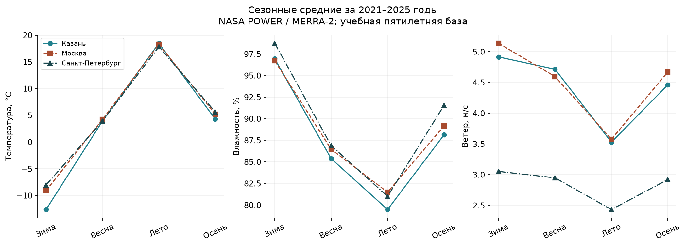
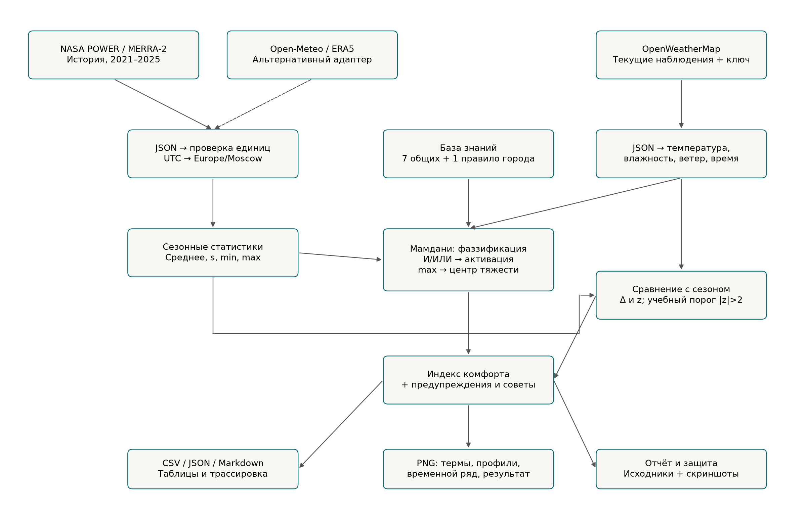
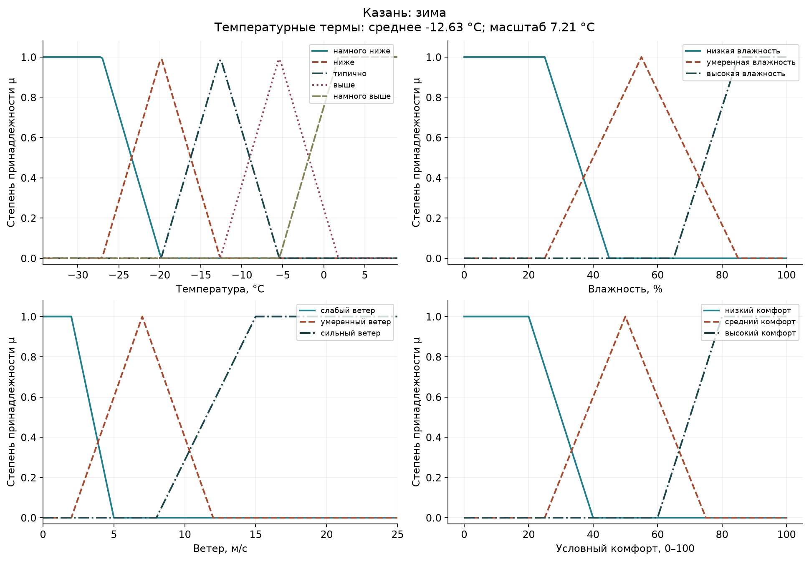
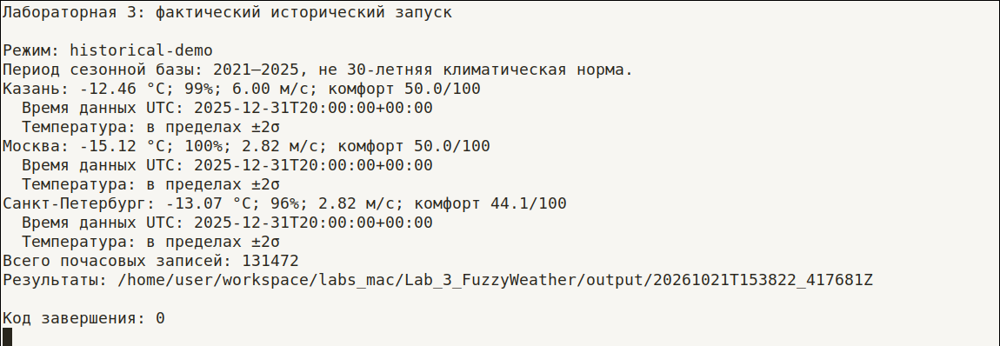
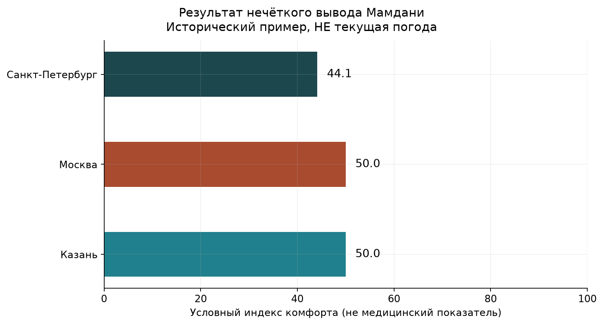
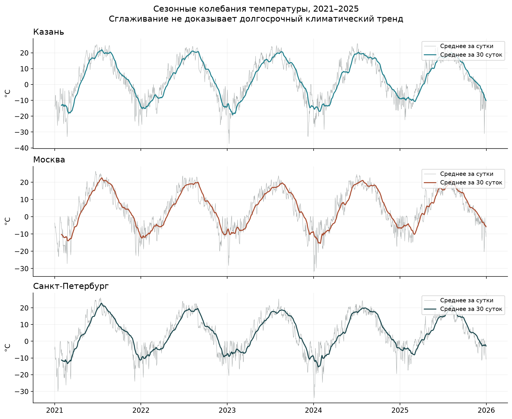

# Лабораторная работа №3

## Экспертная система на основе нечеткой логики для анализа погодных условий городов России

Учебное заведение: ______________________________

Дисциплина: ____________________________________

Выполнил(а): ___________________________________

Группа: ________________________________________

Проверил(а): ___________________________________

Дата сдачи: ____________________________________

Язык реализации: Python. Города: Казань, Москва, Санкт-Петербург.

## Статус выполнения

Расчётная часть реализована и проверена на реальных исторических данных. Код получения текущей погоды OpenWeatherMap готов, но проверенный ключ возвращает HTTP 401: текущие ответы не получены, требование живого получения и сравнения текущей погоды пока не подтверждено.

Все числовые результаты ниже относятся к явно выбранному историческому режиму. Они не подменяют текущую погоду и не свидетельствуют об успешной авторизации OpenWeatherMap.

## Цель работы

Разработать экспертную систему нечёткого вывода Мамдани для анализа температуры, влажности и ветра в трёх городах России. Система должна учитывать сезонный контекст, выявлять отклонения и формировать объяснимые рекомендации.

## Задачи и реализация

| Задача из условия | Реализация и проверенный статус |
|---|---|
| Получить текущую погоду через OpenWeatherMap | `api_client.fetch_current`; код готов, реальный запрос заблокирован HTTP 401 |
| Получить историю за несколько лет | NASA POWER / MERRA-2, 2021–2025; Open-Meteo доступен как альтернативный адаптер |
| Рассчитать нормы четырёх сезонов | `analysis.seasonal_stats`, 12 строк город–сезон |
| Ввести лингвистические переменные | `WeatherFuzzy`, адаптивные температурные термы |
| Реализовать Мамдани в scikit-fuzzy | 8 правил для каждого города, min/max и centroid |
| Сравнить текущие условия с нормами | Функция реализована и проверена на истории; текущие данные ещё не получены |
| Сформировать рекомендации | Нечёткий результат, региональные и защитные правила |
| Построить таблицы и графики | CSV/JSON и 6 графических файлов реального исторического запуска |
| Оформить отчёт | Этот документ, схема draw.io, исходники, скриншот и гайд |

## Теоретическая часть

Экспертная система хранит правила предметной области и выводит заключение по входным данным. В этой работе правила заданы вручную, а числовые параметры температурных термов вычислены из исторического ряда.

Нечёткий терм задаётся функцией принадлежности \(\mu(x)\in[0,1]\). Одно наблюдение может частично соответствовать нескольким термам; принадлежность не является вероятностью.

В реализации Мамдани используются пять этапов: фаззификация; агрегирование условий через минимум для И и максимум для ИЛИ; обрезание выходной функции силой правила; объединение результатов максимумом; дефаззификация центром тяжести:

\[
c^*=\frac{\int_0^{100} y\,\mu_{\mathrm{out}}(y)\,dy}
{\int_0^{100}\mu_{\mathrm{out}}(y)\,dy}.
\]

Используются реальные `Antecedent`, `Consequent`, `Rule`, `ControlSystem` и `ControlSystemSimulation` библиотеки scikit-fuzzy, а не ручной выбор готового балла. Документация с примером построения системы: [scikit-fuzzy](https://scikit-fuzzy.readthedocs.io/en/latest/auto_examples/plot_tipping_problem_newapi.html).

## Экспертные знания и границы модели

Климатические описания используются как контекст из предоставленной методички, а не как заново проверенные метеорологические рекорды. Числа из её справочных таблиц не смешиваются с рассчитанной базой 2021–2025.

- **Казань:** в методичке описан умеренно-континентальный климат с морозной зимой. В модели добавлены правило снижения комфорта при похолодании относительно сезона в сочетании с ветром и отдельный совет при морозе.
- **Москва:** методичка акцентирует летний перегрев и городскую среду. Учебная модель снижает комфорт при температуре выше сезонного среднего и высокой влажности; при жаре добавляет совет о затенённом маршруте.
- **Санкт-Петербург:** методичка описывает морское влияние и изменчивость погоды. Региональное правило объединяет высокую влажность и ветер; при холоде и сырости добавляется совет о защитном верхнем слое.

Эти связи являются авторскими учебными предположениями, не валидированной медицинской моделью. Одна координата на город не описывает районные различия, тепловые острова и все береговые условия.

## Источники и подготовка данных

Для текущей погоды предусмотрен `https://api.openweathermap.org/data/2.5/weather` с координатами, `units=metric`, `lang=ru` и ключом в параметре `appid`. Температура, влажность, ветер и временная метка извлекаются из `main.temp`, `main.humidity`, `wind.speed` и `dt`; параметры описаны в [OpenWeatherMap Current Weather](https://openweathermap.org/current).

Ключ не включён в исходники и отчёт. При HTTP 401 приложение останавливает сетевой запуск и не выдаёт историю за текущие условия; причины ошибки доступа необходимо проверять в аккаунте по [FAQ OpenWeatherMap](https://openweathermap.org/faq).

Исторический адаптер Open-Meteo запрашивает ERA5, но при подготовке сервис вернул дневной лимит. Для воспроизводимого расчёта выбран независимый NASA POWER: параметры `T2M`, `RH2M`, `WS10M`, `community=RE`, `time-standard=UTC`, отдельные запросы по годам, согласно [NASA POWER Hourly API](https://power.larc.nasa.gov/docs/services/api/temporal/hourly/).

Это сеточный реанализ MERRA-2, не прямая запись станции в центре города. Подход к метеорологическим данным описан в [методологии NASA POWER](https://power.larc.nasa.gov/docs/methodology/meteorology/).

Исходные ответы сохранены в `data/history/nasa_raw`, производные почасовые массивы в `data/history`, а происхождение явно указано в метаданных. Для правильной начальной границы дополнительно получено 31 декабря 2020 года; после перехода UTC → Europe/Moscow ряд ограничен 01.01.2021 00:00–31.12.2025 23:00.

Проверяются единицы °C, %, м/с, уникальность временных меток, длины массивов и допустимые диапазоны. Маркер пропуска NASA −999 переводится в отсутствующее значение; непригодные строки учитываются отдельно.


| Город | Часов | Пропуски | Исключено | Покрытие |
|---|---|---|---|---|
| Казань | 43824 | 0 | 0 | 100% |
| Москва | 43824 | 0 | 0 | 100% |
| Санкт-Петербург | 43824 | 0 | 0 | 100% |


Всего \(3\times43824=131472\) пригодных почасовых строк. Это полное покрытие выбранного периода в полученном продукте, а не гарантия точности каждой величины.

## Сезонные статистики

Зима включает декабрь, январь и февраль; весна март–май; лето июнь–август; осень сентябрь–ноябрь. Месяцы группируются внутри календарного периода 2021–2025.

Для каждой группы вычисляются \(\bar{x}=\sum x_i/n\) и выборочное \(s=\sqrt{\sum(x_i-\bar{x})^2/(n-1)}\). Для нового значения рассчитываются \(\Delta=x-\bar{x}\) и \(z=\Delta/s\); при \(s=0\) z не определяется.

Порог \(|z|>2\) используется только как описательная учебная эвристика. Почасовые наблюдения зависимы, сезон объединяет разные месяцы и часы, поэтому порог не означает заданную вероятность и не является проверкой климатического изменения.

В таблице показаны средние температуры, влажности и ветра, а также стандартное отклонение температуры. Остальные отклонения, минимумы, максимумы и количества строк находятся в `seasonal_norms.csv`.


### Казань


| Сезон | T, °C | s(T), °C | RH, % | Ветер, м/с |
|---|---|---|---|---|
| Зима | -12.63 | 7.21 | 96.93 | 4.91 |
| Весна | 3.92 | 9.22 | 85.37 | 4.71 |
| Лето | 18.47 | 4.71 | 79.47 | 3.53 |
| Осень | 4.29 | 7.59 | 88.12 | 4.46 |

### Москва


| Сезон | T, °C | s(T), °C | RH, % | Ветер, м/с |
|---|---|---|---|---|
| Зима | -9.09 | 6.66 | 96.70 | 5.14 |
| Весна | 4.23 | 8.10 | 86.45 | 4.59 |
| Лето | 18.27 | 4.49 | 81.47 | 3.58 |
| Осень | 5.22 | 7.10 | 89.15 | 4.67 |

### Санкт-Петербург


| Сезон | T, °C | s(T), °C | RH, % | Ветер, м/с |
|---|---|---|---|---|
| Зима | -8.03 | 6.93 | 98.73 | 3.05 |
| Весна | 3.91 | 7.31 | 86.88 | 2.95 |
| Лето | 17.82 | 4.23 | 81.00 | 2.43 |
| Осень | 5.63 | 6.98 | 91.53 | 2.92 |




Это учебная пятилетняя база сравнения, а не официальная 30-летняя климатическая норма. Сезонная относительная влажность в этом продукте высока зимой; значения сохранены без ручной «подгонки».

## Архитектура системы

История и текущие наблюдения проходят независимую проверку. Сезонная статистика параметризует Мамдани и одновременно используется для оценки отклонений; обе ветви формируют итоговые объяснения.



Схема сохранена в нативном XML-формате draw.io; её можно открыть через импорт файла. Пунктир обозначает альтернативный источник истории, а не дополнительную смесь рядов.

## Реализация

- **`settings.py`:** координаты, период, сезоны и пути.
- **`api_client.py`:** HTTPS, ошибки, валидация текущих наблюдений и адаптер Open-Meteo.
- **`nasa_history.py`:** сохранение оригинальных ответов и нормализация NASA.
- **`analysis.py`:** проверка качества, сезонная группировка и отклонения.
- **`fuzzy_model.py`:** нечёткая система и объяснимые рекомендации.
- **`charts.py`:** графики функций, профилей, ряда и результата.
- **`main.py`:** общий конвейер, CSV/JSON/Markdown и журнал.
- **`setup_config.py`:** скрытый ввод ключа, локальный файл с ограниченными правами.
- **`test_lab.py`:** 32 автономных теста.

Все файлы содержат комментарии и строки документации. Полный листинг включён отдельно в `SOURCE_CODE.md`; ниже приведён основной вычислительный класс.

### Лингвистические переменные

Универсум температуры −60…60 °C с шагом 0,25; влажности 0…100% с шагом 1; ветра 0…60 м/с с шагом 0,25. Расширение относительно примера методички предотвращает молчаливое обрезание сильного мороза и ветра, а значения за границами явно отвергаются.

Для температуры \(m=\bar{T}\), \(q=\max(s_T,1)\). Используются пять термов: значительно холоднее, прохладнее, типично, теплее и значительно теплее сезонного среднего.

| Терм | Функция | Опорные точки |
|---|---|---|
| Значительно холоднее | Трапеция | −60, −60, m−2q, m−q |
| Прохладнее | Треугольник | m−2q, m−q, m |
| Типично | Треугольник | m−q, m, m+q |
| Теплее | Треугольник | m, m+q, m+2q |
| Значительно теплее | Трапеция | m+q, m+2q, 60, 60 |

Влажность имеет термы «низкая», «умеренная», «высокая»; ветер «слабый», «умеренный», «сильный». Их точки фиксированы экспертно; сезонная адаптация выполнена для температуры, а статистические отклонения считаются для всех трёх показателей.

Выход 0…100 содержит «низкий» комфорт с трапецией [0,0,20,40], «средний» с треугольником [25,50,75] и «высокий» с трапецией [60,80,100,100]. Итоговые подписи используют границы 40 и 70; они не заменяют непрерывный расчёт центра тяжести.

### База правил


| Правило | Содержание |
|---|---|
| R1 | Сильное похолодание относительно сезона → низкий комфорт. |
| R2 | Сильное потепление относительно сезона → низкий комфорт. |
| R3 | Прохладнее обычного → средний комфорт. |
| R4 | Теплее обычного → средний комфорт. |
| R5 | Типичная температура, умеренная влажность и слабый ветер → высокий комфорт. |
| R6 | Типичная температура, но крайняя влажность или умеренный ветер → средний комфорт. |
| R7 | Сильный ветер → низкий комфорт. |


Региональное правило R8 имеет одну из трёх форм:


| Город | Правило |
|---|---|
| Казань | Казань: прохладнее сезонного среднего и ветер → низкий комфорт. |
| Москва | Москва: теплее сезонного среднего и влажно → низкий комфорт. |
| Санкт-Петербург | Петербург: высокая влажность и ветер → низкий комфорт. |




## Результаты исторического запуска

Воспроизводимая команда: `python main.py --historical-demo`. Выбрана последняя пригодная строка каждого города: 31.12.2025 23:00 Europe/Moscow, то есть 20:00 UTC.

Этот запуск проверяет всю вычислительную цепочку на реальных значениях истории. Точка входит в базовый период: это демонстрация, не независимый прогнозный тест.


| Город | T, °C | RH, % | Ветер, м/с | Комфорт /100 |
|---|---|---|---|---|
| Казань | -12.46 | 99 | 6.00 | 50.00 |
| Москва | -15.12 | 100 | 2.82 | 50.00 |
| Санкт-Петербург | -13.07 | 96 | 2.82 | 44.14 |






### Подробный разбор Санкт-Петербурга


Вход: -13.07 °C, 96% и 2.82 м/с. Зимнее среднее равно -8.030 °C, стандартное отклонение 6.930 °C; температурный z равен -0.727.


| Переменная | Терм | Принадлежность |
|---|---|---|
| temperature | below | 0.7273 |
| temperature | typical | 0.2727 |
| humidity | wet | 1.0000 |
| wind | light | 0.7267 |
| wind | breezy | 0.1640 |


Активные правила и фактические силы активации:


| Правило | Активация | Выход |
|---|---|---|
| R3 | 0.7273 | fair |
| R6 | 0.2727 | fair |
| R8 | 0.1640 | poor |


R3 и R6 формируют средний комфорт, а региональное R8 добавляет низкий. После объединения максимумом и расчёта центра тяжести получено 44.1367, то есть 44.14/100 после округления.

Не следует просто усреднять «баллы правил»: в Мамдани интегрируется итоговая функция принадлежности. Полная трассировка всех городов находится в `analysis.json`.


### Отклонения температуры


| Город | Δ, °C | z | Флаг |z|>2 |
|---|---|---|---|
| Казань | +0.169 | +0.023 | Нет |
| Москва | -6.029 | -0.905 | Нет |
| Санкт-Петербург | -5.040 | -0.727 | Нет |


У трёх контрольных наблюдений температурный флаг не сработал. Это означает только нахождение в пределах принятого сезонного порога, а не безопасность пребывания на улице.

### Рекомендации


#### Казань


- Для Казани при морозе добавлен совет защитить лицо и руки от ветра.
- Высокая влажность не доказывает наличие дождя: проверьте отдельный прогноз осадков.
- Это учебная экспертная система, не прогноз опасных явлений и не медицинская рекомендация.

#### Москва


- Высокая влажность не доказывает наличие дождя: проверьте отдельный прогноз осадков.
- Это учебная экспертная система, не прогноз опасных явлений и не медицинская рекомендация.

#### Санкт-Петербург


- Сыро и холодно: предусмотрите ветрозащитный и непромокаемый верхний слой.
- Высокая влажность не доказывает наличие дождя: проверьте отдельный прогноз осадков.
- Это учебная экспертная система, не прогноз опасных явлений и не медицинская рекомендация.


### Временные ряды



Графики показывают выраженные сезонные колебания и различия отдельных лет. Сглаживание используется для чтения ряда и не доказывает долгосрочный климатический тренд.

## Анализ результатов

В выбранном историческом продукте зимнее среднее Казани ниже, чем у двух других городов, а летние средние близки. Эти выводы относятся к конкретным координатам, периоду и реанализу, не ко всем районам городов или любой климатической базе.

В контрольной точке Казань и Москва получили по 50 баллов, несмотря на разные температуры. Причина в активных правилах: их заключения ведут к одному симметричному среднему выходному терму.

Санкт-Петербург получил меньший индекс из-за регионального правила влажности и ветра. Это иллюстрирует влияние базы знаний, но само по себе не доказывает, что одинаковая погода физиологически ощущается жителями городов именно так.

Исторические и текущие данные поступают из разных продуктов, поэтому возможны систематические различия, не связанные с погодной аномалией. Для практической системы потребуются согласование источников, более точная сезонность и проверка экспертных правил.

## Проверка и воспроизведение

В папке проекта выполнить `python -m unittest -v`: 32 теста проверяют API-ошибки без утечки ключа, единицы и часовые пояса, очистку, статистику, покрытие термов, региональное правило и независимый расчёт центра тяжести. Сетевые тесты используют фикстуры и не доказывают действительность ключа.

Исторический запуск выполнен на настоящих загруженных данных и сохранён полностью. Проверка выполнена в Linux; инструкции рассчитаны на MacBook, но сам пользовательский Mac удалённо не проверялся.

Для завершения живой части нужно локально запустить `python setup_config.py`, затем `python main.py --refresh-current`. Успешный результат должен содержать три настоящих ответа OpenWeatherMap, актуальные времена наблюдений и новые таблицы/графики; до этого цель работы достигнута только в вычислительной и исторической частях.

## Выводы

Реализована объяснимая нечёткая система с адаптацией к городу и сезону, контролем качества данных, сохранением первичных ответов и трассировкой правил. Получен опыт разделения API-ошибок, исторического анализа и собственно нечёткого вывода.

Основные сложности: ограничение исторического API, приведение часовых поясов и единиц, обработка крайних значений и отказ авторизации текущего сервиса. Исторический анализ проверен; текущая интеграция остаётся ограничением, которое нельзя скрывать демонстрационными результатами.

## Документация и материалы

Основание работы: предоставленная методичка «Лабораторная 3 Погода Fuzzy ЯП на выбор», разделы задач и оформления отчёта. Дополнительные материалы `README.md` и `DEFENSE.md` содержат команды и разбор защиты.

- **OpenWeatherMap:** поля текущих данных и единицы описаны на [https://openweathermap.org/current](https://openweathermap.org/current).
- **Ошибки доступа:** возможные причины 401 перечислены на [https://openweathermap.org/faq](https://openweathermap.org/faq).
- **NASA POWER:** параметры и периодичность API описаны на [https://power.larc.nasa.gov/docs/services/api/temporal/hourly/](https://power.larc.nasa.gov/docs/services/api/temporal/hourly/).
- **NASA POWER, методология:** происхождение метеорологических данных описано на [https://power.larc.nasa.gov/docs/methodology/meteorology/](https://power.larc.nasa.gov/docs/methodology/meteorology/).
- **Open-Meteo:** альтернативный исторический адаптер использует [https://open-meteo.com/en/docs/historical-weather-api](https://open-meteo.com/en/docs/historical-weather-api).
- **scikit-fuzzy:** пример системы управления опубликован на [https://scikit-fuzzy.readthedocs.io/en/latest/auto_examples/plot_tipping_problem_newapi.html](https://scikit-fuzzy.readthedocs.io/en/latest/auto_examples/plot_tipping_problem_newapi.html).

## Приложение: вычислительная модель

Ниже показан класс, который создаёт и исполняет Мамдани. Полный код всех модулей с комментариями расположен в `SOURCE_CODE.md` и в отдельных `.py`-файлах.

```python

"""Настоящий Mamdani: min для AND, max для OR/аккумуляции, centroid."""
import numpy as np
import skfuzzy as fuzz
from skfuzzy import control as ctrl
from api_client import valid_number
from settings import CITIES

TERM_RU = {
    "far_below": "значительно холоднее сезонного среднего",
    "below": "прохладнее сезонного среднего", "typical": "типично для сезона",
    "above": "теплее сезонного среднего",
    "far_above": "значительно теплее сезонного среднего",
    "dry": "низкая влажность", "moderate": "умеренная влажность",
    "wet": "высокая влажность", "light": "слабый ветер",
    "breezy": "умеренный ветер", "strong": "сильный ветер",
    "poor": "низкий комфорт", "fair": "средний комфорт", "good": "высокий комфорт",
}


class WeatherFuzzy:
    def __init__(self, city, season, mean, std):
        if city not in CITIES or not np.isfinite(mean) or not -40 < mean < 40:
            raise ValueError("Некорректный город или средняя температура.")
        if not np.isfinite(std) or std < 0:
            raise ValueError("Некорректное стандартное отклонение.")
        self.city, self.season = city, season
        self.mean, self.scale = float(mean), max(float(std), 1.0)
        if mean - 2 * self.scale <= -60 or mean + 2 * self.scale >= 60:
            raise ValueError("Сезонные термы выходят за универсум.")
        t = ctrl.Antecedent(np.linspace(-60, 60, 481), "temperature")
        h = ctrl.Antecedent(np.arange(101), "humidity")
        w = ctrl.Antecedent(np.linspace(0, 60, 241), "wind")
        c = ctrl.Consequent(np.linspace(0, 100, 1001), "comfort", defuzzify_method="centroid")
        m, s = self.mean, self.scale
        t["far_below"] = fuzz.trapmf(t.universe, [-60, -60, m-2*s, m-s])
        t["below"] = fuzz.trimf(t.universe, [m-2*s, m-s, m])
        t["typical"] = fuzz.trimf(t.universe, [m-s, m, m+s])
        t["above"] = fuzz.trimf(t.universe, [m, m+s, m+2*s])
        t["far_above"] = fuzz.trapmf(t.universe, [m+s, m+2*s, 60, 60])
        h["dry"] = fuzz.trapmf(h.universe, [0, 0, 25, 45])
        h["moderate"] = fuzz.trimf(h.universe, [25, 55, 85])
        h["wet"] = fuzz.trapmf(h.universe, [65, 85, 100, 100])
        w["light"] = fuzz.trapmf(w.universe, [0, 0, 2, 5])
        w["breezy"] = fuzz.trimf(w.universe, [2, 7, 12])
        w["strong"] = fuzz.trapmf(w.universe, [8, 15, 60, 60])
        c["poor"] = fuzz.trapmf(c.universe, [0, 0, 20, 40])
        c["fair"] = fuzz.trimf(c.universe, [25, 50, 75])
        c["good"] = fuzz.trapmf(c.universe, [60, 80, 100, 100])
        definitions = [
            ("R1", t["far_below"], "poor", "Сильное похолодание относительно сезона → низкий комфорт."),
            ("R2", t["far_above"], "poor", "Сильное потепление относительно сезона → низкий комфорт."),
            ("R3", t["below"], "fair", "Прохладнее обычного → средний комфорт."),
            ("R4", t["above"], "fair", "Теплее обычного → средний комфорт."),
            ("R5", t["typical"] & h["moderate"] & w["light"], "good",
             "Типичная температура, умеренная влажность и слабый ветер → высокий комфорт."),
            ("R6", t["typical"] & (h["dry"] | h["wet"] | w["breezy"]), "fair",
             "Типичная температура, но крайняя влажность или умеренный ветер → средний комфорт."),
            ("R7", w["strong"], "poor", "Сильный ветер → низкий комфорт."),
        ]
        if city == "spb":
            extra = (h["wet"] & (w["breezy"] | w["strong"]),
                     "Петербург: высокая влажность и ветер → низкий комфорт.")
        elif city == "moscow":
            extra = (t["above"] & h["wet"],
                     "Москва: теплее сезонного среднего и влажно → низкий комфорт.")
        else:
            extra = (t["below"] & (w["breezy"] | w["strong"]),
                     "Казань: прохладнее сезонного среднего и ветер → низкий комфорт.")
        definitions.append(("R8", extra[0], "poor", extra[1]))
        self.rule_specs = [{"id": i, "output": o, "text": text} for i, _, o, text in definitions]
        self.rules = [ctrl.Rule(antecedent, c[output], label=i)
                      for i, antecedent, output, _ in definitions]
        self.system = ctrl.ControlSystem(self.rules)
        self.variables = {"temperature": t, "humidity": h, "wind": w, "comfort": c}

    def evaluate(self, temperature, humidity, wind):
        values = {
            "temperature": valid_number(temperature, -60, 60, "temperature"),
            "humidity": valid_number(humidity, 0, 100, "humidity"),
            "wind": valid_number(wind, 0, 60, "wind"),
        }
        simulation = ctrl.ControlSystemSimulation(self.system, clip_to_bounds=False)
        for key, value in values.items():
            simulation.input[key] = value
        simulation.compute()
        if "comfort" not in simulation.output:
            raise RuntimeError("Ни одно правило не активировано.")
        score = float(simulation.output["comfort"])
        memberships = {}
        for variable, value in values.items():
            var = self.variables[variable]
            memberships[variable] = {
                term: float(fuzz.interp_membership(var.universe, obj.mf, value))
                for term, obj in var.terms.items()
            }
        trace = [{**spec, "activation": float(rule.aggregate_firing[simulation] or 0)}
                 for spec, rule in zip(self.rule_specs, self.rules)]
        return {
            "comfort": score,
            "comfort_label": "низкий" if score < 40 else "средний" if score < 70 else "высокий",
            "memberships": memberships, "rules": trace,
            "temperature_scale": self.scale, "temperature_mean": self.mean,
        }

```
